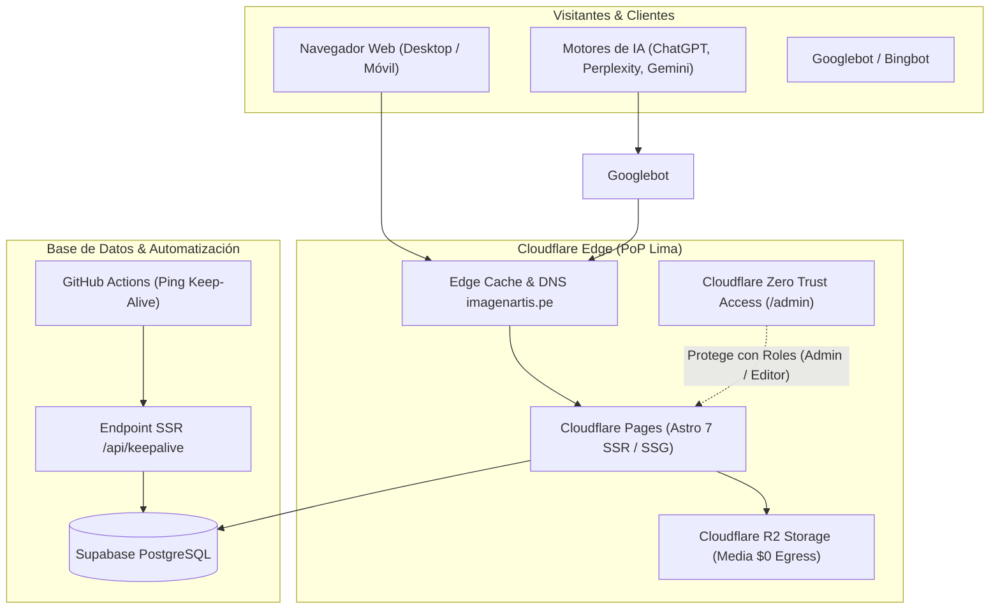

# 01. Arquitectura Técnica & Stack Tecnológico

> **Proyecto**: Imagenartis Web (Producción)  
> **Dominio Oficial**: `https://imagenartis.pe`  
> **Hosting & Edge**: Cloudflare Pages / Workers  
> **Base de Datos & Auth**: Supabase PostgreSQL + Cloudflare Zero Trust  

---

## 1. Visión General de la Infraestructura

La arquitectura de **Imagenartis** está diseñada bajo un modelo **Edge-First e Híbrido (SSG + SSR)**, garantizando que el 95% del sitio cargue de forma ultra-rápida desde la red perimetral de Cloudflare en Lima (0 a 15ms de latencia), mientras que las operaciones dinámicas (CMS y keep-alive) se procesan mediante funciones de servidor en Cloudflare Workers.



---

## 2. Tecnologías Principales

| Capa | Tecnología | Justificación Técnica |
| :--- | :--- | :--- |
| **Framework Web** | **Astro 7.3+** | Salida estática hiper-optimizada con hidratación parcial (`client:load`, `client:visible`). Cero JavaScript innecesario en cliente. |
| **Biblioteca UI** | **React 19** | Manejo de componentes dinámicos con hooks modernos para el canvas interactivo, la galería Pinterest y filtros de búsqueda difusa. |
| **Estilos** | **Tailwind CSS v4** | Motor de estilos de última generación integrado directamente con `@tailwindcss/vite` para compilación instantánea y bundle CSS mínimo. |
| **Enrutamiento** | **Astro ClientRouter** | Navegación SPA con transiciones de página (View Transitions) suaves, manteniendo el Navbar persistente sin parpadeos ni recargas completas. |
| **Buscador Galería** | **Fuse.js** | Búsqueda difusa en cliente tolerante a errores ortográficos, filtrando por títulos, clientes, técnicas y etiquetas. |
| **Hosting & CDN** | **Cloudflare Pages** | Despliegues automáticos desde Git, SSL automático, protección DDoS y CDN distribuida con nodo local en Perú. |
| **Base de Datos** | **Supabase** | PostgreSQL administrado con API REST instantánea para la gestión de secciones editables del CMS. |

---

## 3. Resiliencia & Fallback del CMS (100% Tolerante a Fallos)

Para evitar que una caída de red o lentitud en Supabase rompa la web, la capa de datos en [`src/lib/cms.ts`](file:///f:/IMAGEN%20ARTIS/wil/githubrep/imagenartis/src/lib/cms.ts) cuenta con una arquitectura de **doble capa**:

1. **Capa Primaria (Supabase)**: En tiempo de build o petición de servidor, se consulta la tabla `site_sections` en un solo viaje de red paralelo (`fetchAllSections()`).
2. **Capa de Respaldo Local (JSONs)**: Si Supabase no responde, devuelve error o el proyecto está pausado, la aplicación automáticamente usa los archivos JSON locales en `src/content/` (`getDefaultCmsData()`). **La web nunca se cae ni muestra errores al visitante.**

---

## 4. Sistema Keep-Alive para Supabase (Cero Suspensión del Plan Free)

El plan gratuito de Supabase pausa los proyectos tras 7 días sin consultas directas. Para resolver esto de forma 100% automatizada y gratuita:

1. **Endpoint SSR**: Se implementó [`src/pages/api/keepalive.ts`](file:///f:/IMAGEN%20ARTIS/wil/githubrep/imagenartis/src/pages/api/keepalive.ts) (`prerender = false`), que realiza una consulta ligera `SELECT id FROM site_sections LIMIT 1`.
2. **Cron en GitHub Actions**: Se configuró [`.github/workflows/supabase-keepalive.yml`](file:///f:/IMAGEN%20ARTIS/wil/githubrep/imagenartis/.github/workflows/supabase-keepalive.yml), que ejecuta una petición fantasma programada:
   ```yaml
   schedule:
     - cron: '0 12 * * 1,4' # Lunes y Jueves a las 12:00 UTC
   ```
   Esto renueva la actividad del proyecto dos veces por semana, impidiendo que Supabase se cierre jamás.

---

## 5. Seguridad & Autenticación de `/admin` con Cloudflare Zero Trust

En lugar de construir formularios de login vulnerables a fuerza bruta o inyecciones SQL, el panel administrativo [`/admin`](file:///f:/IMAGEN%20ARTIS/wil/githubrep/imagenartis/src/pages/admin.astro) se protege a nivel de red con **Cloudflare Zero Trust Access**:

- **Cómo opera**: Cloudflare intercepta cualquier petición a `imagenartis.pe/admin*` antes de que toque el servidor Astro.
- **Método de acceso**: Envía un código PIN de 6 dígitos (One-Time PIN) al correo corporativo autorizado o requiere inicio de sesión con Google Workspace.
- **Roles y Permisos**:
  - `Admin`: Permiso de acceso total para configuración de empresa, layout y datos universales.
  - `Editor`: Permiso para actualizar fichas de galería, fotos y textos de portafolio.
- **Cero código que mantener**: No requiere almacenamiento de contraseñas con bcrypt ni mantenimiento de tablas de sesiones en base de datos.

---

## 6. Variables de Entorno & Protección de Secretos

La política de seguridad de código del repositorio es estricta:

- **Archivo Local [`.env`](file:///f:/IMAGEN%20ARTIS/wil/githubrep/imagenartis/.env)**: Guarda las claves reales de desarrollo (`PUBLIC_SUPABASE_URL`, `PUBLIC_SUPABASE_ANON_KEY`, etc.).
- **Archivo [`.gitignore`](file:///f:/IMAGEN%20ARTIS/wil/githubrep/imagenartis/.gitignore)**: Blindado para ignorar `.env`, `.env.*`, `.dev.vars`, `.dev.vars.*`, `.wrangler/`, archivos `.key` y `.pem`.
- **Configuración en la Nube**: En producción, las claves se configuran únicamente dentro del panel de **Cloudflare Pages** (`Settings > Environment variables`), garantizando que **GitHub nunca contenga credenciales sensibles**.
