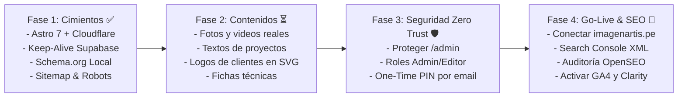

# 05. Hoja de Ruta Master & Checklist de Lanzamiento a Producción

> **Estado Actual**: Fase 1 Completada (Cimientos, build verificado, sitemap, robots, Schema.org)  
> **Fase en Curso**: Fase 2 (Carga de fotografías, videos y textos reales en `/public`)  

---

## 1. Hoja de Ruta por Fases

---

## 2. Checklist Técnico Previo al Lanzamiento (Go-Live)

### Bloque A: Carga y Validación de Activos (En Curso)
- [x] Carpeta `public/Inicio/` creada con fotografías del Antes/Después de camión Dorcher y Gaspetrol.
- [ ] Completar fotografías de proyectos en `public/galeria/`.
- [ ] Verificar que todos los proyectos en [`src/lib/projects.ts`](file:///f:/IMAGEN%20ARTIS/wil/githubrep/imagenartis/src/lib/projects.ts) tengan sus imágenes y descripciones reales.
- [ ] Revisar que el número de WhatsApp oficial en [`src/content/siteSettings/data.json`](file:///f:/IMAGEN%20ARTIS/wil/githubrep/imagenartis/src/content/siteSettings/data.json) y [`Navbar.tsx`](file:///f:/IMAGEN%20ARTIS/wil/githubrep/imagenartis/src/components/ui/Navbar.tsx) sea el definitivo (`+51 994 097 417`).

### Bloque B: Infraestructura Cloudflare & Producción
- [x] Repositorio Git limpio y sincronizado en rama `master`.
- [x] Build de producción exitoso con `@astrojs/cloudflare` (62 páginas estáticas + endpoints SSR).
- [ ] Vincular dominio personalizado en Cloudflare Pages: `imagenartis.pe` y `www.imagenartis.pe`.
- [ ] Activar SSL/TLS en modo **Full (Strict)** en Cloudflare.
- [ ] Cargar variables de entorno en el panel de Cloudflare Pages:
  - `PUBLIC_SUPABASE_URL`
  - `PUBLIC_SUPABASE_ANON_KEY`
  - `PUBLIC_GA_ID` (cuando se cree el flujo de medición en Google Analytics)
  - `PUBLIC_CLARITY_ID` (cuando se cree el proyecto en Microsoft Clarity)

### Bloque C: Seguridad de Panel `/admin`
- [ ] Crear aplicación en Cloudflare Zero Trust:
  - **Application path**: `imagenartis.pe/admin*`
  - **Políticas de Acceso**: Permitir acceso únicamente a correos autorizados (ej: `@imagenartis.pe` o correos específicos de administradores).
  - **Método**: One-Time PIN por email o Google Login.

### Bloque D: Buscadores, SEO & Verificación en Google
- [x] Generación de `https://imagenartis.pe/sitemap-index.xml` verificada.
- [x] `public/robots.txt` activo bloqueando rutas privadas `/admin`.
- [x] Schema.org LocalBusiness inyectado en `Layout.astro` con coordenadas de Balconcillo, La Victoria.
- [ ] Dar de alta la propiedad `imagenartis.pe` en **Google Search Console**.
- [ ] Enviar la URL del sitemap en Search Console: `https://imagenartis.pe/sitemap-index.xml`.
- [ ] Verificar la indexación de las páginas principales (`/`, `/galeria`, `/nosotros`, `/wrapauto`, `/brandcomercial`, `/diseno`).

### Bloque E: Auditoría de Rendimiento & Calidad
- [ ] Correr prueba de Google PageSpeed Insights (Objetivo: Performance móvil > 90, Accesibilidad > 95, SEO = 100).
- [ ] Verificar que el Cumulative Layout Shift (CLS) se mantenga por debajo de 0.05.
- [ ] Probar consultas en ChatGPT y Perplexity: *"¿Dónde hacer wrap automotriz profesional en Lima?"* para validar que la información estructurada de la web empiece a ser indexada y citada por la IA.
